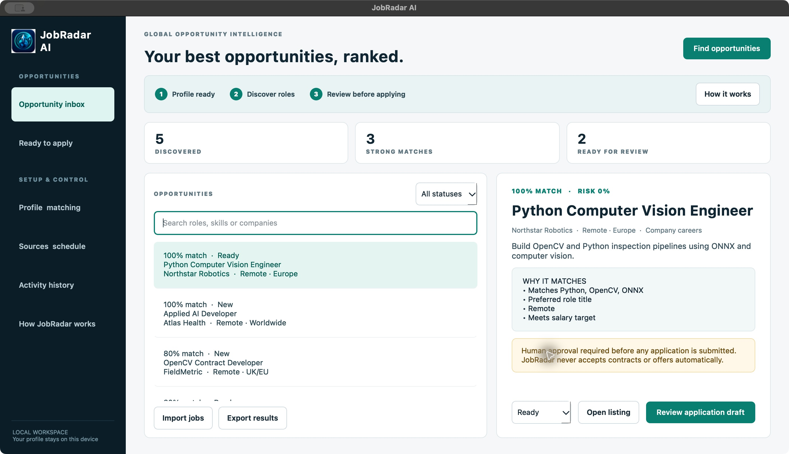

# JobRadar AI

A privacy-conscious global opportunity inbox built with Python and PySide6. It discovers, deduplicates, scores and organises jobs while keeping a human approval step before any application or contractual action.



## Features

- Transparent 0–100 match scoring
- Skill, title, remote and salary matching
- Scam-language risk detection
- Duplicate opportunity detection
- Searchable opportunity inbox
- Approval-based application preparation queue
- Local SQLite storage
- Sample sources for safe offline evaluation
- Live public connectors for Remotive and Remote OK
- Persistent candidate profile and matching preferences
- Status workflow from discovery through offer or archive
- Local application activity log
- CSV import and export
- Non-blocking discovery with partial-source failure handling
- Unsafe-link protection and responsible-automation guardrails
- Editable role-specific application drafts with explicit applied confirmation
- Native JobRadar icon for macOS and Windows packages

## Run

```bash
python3 -m venv .venv
source .venv/bin/activate
pip install -r requirements.txt
python run.py
```

## Test

```bash
pip install -r requirements-dev.txt
pytest -q
```

## Responsible automation

JobRadar can automate discovery, scoring, deduplication and preparation. Submitting applications is restricted to supported sources and requires explicit user approval. Accepting offers or contracts is never automated.

## Build

Install development dependencies, then run `python build.py`. PyInstaller produces a native bundle in `dist/`. Build separately on Windows and macOS.

## Data and privacy

Profiles, opportunities and audit events are stored in the operating system's application-data directory. No résumé or personal profile data is sent to the public discovery sources.
